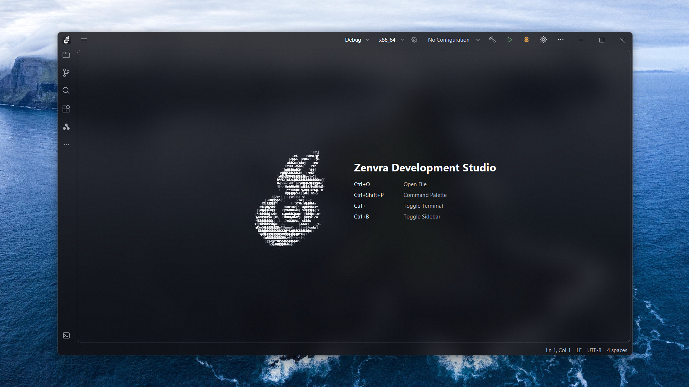

<div align="center">

<h1> Zenvra Development Studio </h1>


**The open-source IDE minimalist built natively in C++20.**

No Electron. No browser runtime. No compromises.

[Why ZDE](#why-zde) · [What's inside](#whats-inside) · [Quick start](#quick-start) · [Installers and packages](#installers-and-packages) · [Architecture](#architecture) · [Roadmap](#roadmap) · [Contributing](#contributing)

</div>



<!-- <p align="center">
  <sub><strong>Zenvra Dark</strong> and <strong>Zenvra Light</strong> — one native workbench, zero browser engines.</sub>
</p> -->


## Why ZDE

JetBrains proved how good a deeply integrated IDE can feel. VS Code proved how far an open ecosystem can reach. **ZDE is an independent bet on both ideas at once** — a real desktop IDE, built natively from the first pixel, for developers who want JetBrains-style integration without a closed core or a browser under the hood.

There is no Electron shell, no embedded browser, and no native widget kit deciding how the app should look. The titlebar, editor, explorer, terminal, panels, themes, and language client are all part of the same C++20 codebase. That keeps ZDE lean, predictable, and unusually easy to bend to your workflow.

> **Status:** `0.1.0` is an early preview. Windows is the most complete backend today; Linux/X11 and macOS are in active development. Expect sharp edges — and help us smooth them.

## What's inside

### A native workbench
- Custom-drawn titlebar, menus, toolbars, split panes, modals, and flyouts.
- **Win32**, **X11**, and **Cocoa** platform backends behind one platform layer.
- Explorer, search, run, terminal, plugins, problems, and shader sandbox in one window.
- Five built-in themes: light, dark, high contrast, and two backdrop-blur modern variants.
- Resizable panels, UI scaling, and independent UI/editor/terminal font settings.

### An editor that keeps up
- Syntax highlighting for C/C++, Rust, Python, JavaScript/TypeScript, Java, C#, Go, Kotlin, CMake, Meson, HTML/CSS, JSON, YAML, shell, Markdown, and Assembly.
- Multi-cursor editing, code folding, minimap, brace matching, whitespace rendering, and word wrap.
- Font ligatures, configurable tab size, line height, and cursor styles.
- Vim mode with motions, operators, visual mode, and leader-key mappings.
- Tabs, split editors, breadcrumbs, and automatic reload of externally changed files.

### Real language intelligence
- Native **LSP** client over stdio with document sync and server lifecycle management.
- Completion, hover, signature help, diagnostics, semantic tokens, and go-to-definition.
- Automatic server discovery for 15+ languages, from C/C++, Rust, Go, and Python to TypeScript, Java, C#, Lua, Zig, and CMake.
- Language servers can be installed and managed as plugins — not baked into the editor.

### A terminal that belongs
- **ConPTY** on Windows and **POSIX PTY** on Linux and macOS.
- Multiple sessions, scrollback, selection, mouse reporting, and resize handling.
- Theme-aware rendering with your chosen terminal font and ligatures.

### Build, run, and preview
- Project and toolchain detection for CMake, Cargo, Python, Java, and Free Pascal.
- Integrated CMake build/run pipeline with run configurations and captured output.
- Real-time **GLSL shader sandbox**.
- Image, audio, and video preview powered by **FFmpeg**.

### Extensible by design
- Plugin manifests, dependency resolution, install/uninstall, and a marketplace catalog.
- Theme and language-server plugins without rebuilding the core.
- Searchable settings with schema validation and user/workspace scopes.
- MIT-licensed application code. Fork it, audit it, ship it.

## Quick start

### Prerequisites
- **CMake 3.25+**
- A **C++20 compiler**: Visual Studio 2022 (MSVC), GCC/MinGW, or Clang
- **Ninja** for the Ninja presets
- **Internet access on first configure** — CPM.cmake fetches dependencies automatically

### Windows

```powershell
git clone https://github.com/Zenvra-Studios/ZDE-minimal.git
cd ZDE-minimal
cmake --preset windows-vs2022-debug
cmake --build --preset windows-vs2022-debug
```

Launch `build\windows-vs2022-debug\bin\Debug\ZDE.exe`.

Prefer Ninja? Use `windows-ninja-debug` (GCC/MinGW) or `windows-clang-ninja-debug` (Clang).

### Linux

```bash
git clone https://github.com/Zenvra-Studios/ZDE-minimal.git
cd ZDE-minimal
cmake --preset linux-debug
cmake --build --preset linux-debug
```

### macOS

```bash
git clone https://github.com/Zenvra-Studios/ZDE-minimal.git
cd ZDE-minimal
cmake --preset macos-debug
cmake --build --preset macos-debug
```

Build output stays outside the source tree:

```text
build/<preset>/bin/<config>/    # executables and runtime libraries
build/<preset>/lib/<config>/    # static and import libraries
```

<details>
<summary><strong>More presets and IDE setup</strong></summary>

- `windows-vs2022-debug` / `windows-vs2022-release`
- `windows-ninja-debug` / `windows-ninja-release`
- `windows-clang-ninja-debug` / `windows-clang-ninja-release`
- `linux-debug` / `linux-release`
- `linux-mingw-debug` / `linux-mingw-release` (cross-compile from Linux)
- `macos-debug` / `macos-release`

Open the repository folder directly in Visual Studio, CLion, or your preferred IDE. Every preset enables `CMAKE_EXPORT_COMPILE_COMMANDS`, and the Ninja presets generate `compile_commands.json` for clangd and other tooling. The full list lives in [CMakePresets.json](CMakePresets.json).

</details>

## Installers and packages

### Windows setup

Build a Release configuration, then run the Inno Setup script:

```powershell
cmake --preset windows-clang-ninja-release
cmake --build --preset windows-clang-ninja-release
powershell -ExecutionPolicy Bypass -File Scripts\build_installer.ps1
```

The installer is written to `build/installer/ZDE-<version>-windows-x64-setup.exe` and includes:

- per-user or all-users installation;
- the MIT license page;
- destination and Start Menu selection;
- an optional desktop shortcut;
- optional **Open with ZDE** context menus for files and folders;
- the app-local MSVC runtime, so no separate VC++ Redistributable is required;
- a standard uninstall entry and a launch-after-install option.

Inno Setup 7 is recommended; Inno Setup 6 also works. Pass `-Version`, `-BuildDir`, `-OutputDir`, `-RuntimeDir`, or `-InnoSetupPath` to override the defaults. Regenerate the wizard artwork with `Scripts\generate_assets.ps1 -Force`.

### Linux packages

```bash
chmod +x Scripts/build-packages.sh
./Scripts/build-packages.sh all   # or: deb | rpm | tar | arch
```

CPack packages land in `build/packages`; the Arch recipe builds with `makepkg`.

## Architecture

ZDE keeps the workbench, services, platform, and native drivers in separate layers. A backend can change without rewriting the UI; a driver can be added without touching the editor.

```text
┌────────────────────────────────────────────────────────────────────┐
│ ZDE Workbench                                                      │
│ Chrome · Editor · Explorer · Terminal · Panels · Settings          │
├────────────────────────────────────────────────────────────────────┤
│ Application · Commands · Services · Language (LSP) · Plugins       │
├────────────────────────────────────────────────────────────────────┤
│ Platform layer — Win32 · X11 · Cocoa                               │
├────────────────────────────────────────────────────────────────────┤
│ Drivers — Graphics (OpenGL) · Media (FFmpeg) · Audio               │
└────────────────────────────────────────────────────────────────────┘
```

| Path | What lives there |
| --- | --- |
| `Source/` | Workbench, editor, platform backends, services, language client, plugins |
| `Drivers/` | Native graphics, media, and audio driver layer |
| `Assets/` | Fonts, icons, syntax grammars, and the README hero image |
| `plugins/` | Theme, tool, and language-server plugins |
| `manifest/` | Runtime manifest and shared-library list |
| `Cmake/` | CMake helpers, toolchains, and Linux packaging |
| `Scripts/` | Build, installer, asset, and packaging scripts |
| `Tests/` | Unit and integration tests |
| `Docs/` | Documentation and design notes |

## Roadmap

ZDE is already usable for editing and running projects on Windows. The next milestones are:

- [ ] Finish the first-class Git source control panel — staging, commits, branches, history, and diffs.
- [ ] Add debugger adapters for GDB, LLDB, and DAP.
- [ ] Remote workspaces.
- [ ] Live collaboration.
- [ ] A stable public plugin API and curated marketplace.

Have a different priority? Open an issue and make the case.

## Contributing

ZDE is built in public. Whether you write C++, design themes, test on Linux, or report a rough edge, you are welcome here.

- **Found a bug?** [Open an issue](https://github.com/Zenvra-Studios/ZDE-minimal/issues) with your OS, build preset, and reproduction steps.
- **Have an idea?** Start with an issue so the design can be discussed before a large pull request.
- **Sending code?** Keep changes focused, respect the module boundaries in `Source/`, and run the relevant tests in `Tests/`.
- **New here?** Build the project, pick a small issue, and ask questions along the way.

If ZDE is the IDE you want to exist, star the repository and help us build it in public.

## License

ZDE is released under the [MIT License](LICENSE). Third-party components retain their own licenses; see `Assets/`, `ThirdParty/`, and the `COPYING*` files for details.

JetBrains is a trademark of JetBrains s.r.o. ZDE is an independent project and is not affiliated with or endorsed by JetBrains.

